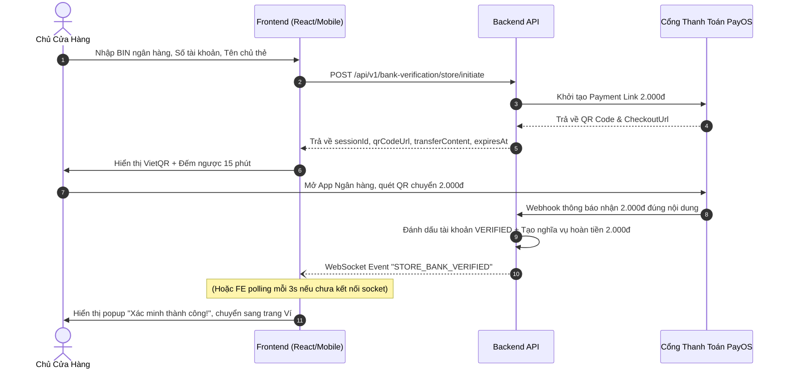
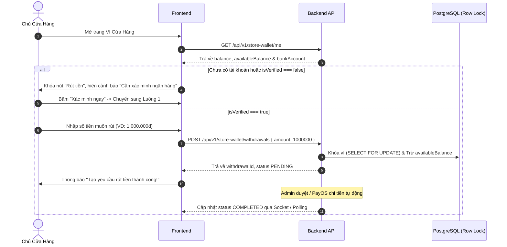

# Hướng Dẫn Tích Hợp Frontend: Xác Minh Tài Khoản Ngân Hàng, Hoàn Tiền & Rút Tiền Ví Cửa Hàng

- **Ngày lập:** 11/11/2026
- **Mục tiêu:** Hướng dẫn chi tiết cho đội ngũ Frontend triển khai trọn vẹn 3 luồng tài chính:
  1. Xác minh tài khoản ngân hàng cửa hàng (Khoản nạp thử 2.000 VNĐ).
  2. Tự động hoàn tiền 2.000 VNĐ sau khi xác minh.
  3. Rút tiền từ Ví Cửa Hàng về tài khoản ngân hàng đã xác thực.

---

## 1. Tổng Quan Kiến Trúc & Quy Tắc Bắt Buộc

1. **Điều kiện tiên quyết để rút tiền:**
   Cửa hàng chỉ có thể tạo yêu cầu rút tiền khi đã có tài khoản ngân hàng ở trạng thái `isVerified: true`.
2. **Cơ chế xác thực 2.000đ (Penny Verification):**
   Hệ thống yêu cầu cửa hàng chuyển khoản thử đúng **2.000 VNĐ** kèm nội dung chuyển khoản duy nhất (VD: `ST VERIFY 45`) để hệ thống tự động đối soát chính chủ qua webhook.
3. **Cơ chế hoàn tiền 2.000đ tự động:**
   Ngay sau khi xác minh thành công, Backend tự động kích hoạt tiến trình hoàn trả 2.000 VNĐ về tài khoản nguồn. **Frontend không cần gọi API hoàn tiền.**
4. **Quy tắc Server Fee Authority:**
   Khi rút tiền ví, Frontend **chỉ gửi số tiền muốn rút (`amount`)**, không tự tính phí hay gửi `fee`/`netAmount`. Backend có toàn quyền tính phí máy chủ để đảm bảo an toàn.

---

## 2. Luồng 1: Xác Minh Tài Khoản Ngân Hàng Cửa Hàng (2.000 VNĐ)

### 2.1. Sơ đồ tuần tự (Sequence Diagram)


---

### 2.2. Hợp đồng API chi tiết

#### API 1.1: Khởi tạo phiên xác thực ngân hàng
- **Method & URL:** `POST /api/v1/bank-verification/store/initiate`
- **Headers:** 
  - `Content-Type: application/json`
  - `Authorization: Bearer <store_access_token>`
- **Request Body:**
  ```json
  {
    "bankBin": "970422",          // Mã BIN ngân hàng 6 chữ số (VD: MB Bank: 970422, VCB: 970436)
    "accountNumber": "0123456789", // Số tài khoản ngân hàng cần liên kết
    "accountHolderName": "NGUYEN VAN A" // Tên chủ tài khoản in hoa không dấu
  }
  ```
- **Response Thành Công (HTTP 200/201):**
  ```json
  {
    "success": true,
    "message": "Khởi tạo phiên xác thực tài khoản ngân hàng thành công",
    "data": {
      "sessionId": "45",
      "status": "PENDING",
      "verificationAmount": 2000,
      "transferContent": "ST VERIFY 45",
      "qrCodeUrl": "https://img.vietqr.io/image/970422-0123456789-compact2.png?amount=2000&addInfo=ST%20VERIFY%2045",
      "checkoutUrl": "https://pay.payos.vn/web/...",
      "expiresAt": "2026-11-11T02:00:00.000Z"
    }
  }
  ```

#### API 1.2: Tra cứu trạng thái phiên xác minh (Polling)
- **Method & URL:** `GET /api/v1/bank-verification/store/status/:sessionId`
- **Headers:** `Authorization: Bearer <store_access_token>`
- **Response khi đang chờ chuyển khoản (HTTP 200):**
  ```json
  {
    "success": true,
    "data": {
      "sessionId": "45",
      "status": "PENDING",
      "verificationAmount": 2000,
      "refundStatus": null
    }
  }
  ```
- **Response khi xác minh thành công (HTTP 200):**
  ```json
  {
    "success": true,
    "data": {
      "sessionId": "45",
      "status": "VERIFIED",
      "bankBin": "970422",
      "bankAccountMasked": "******6789",
      "verifiedAt": "2026-11-11T01:45:00.000Z",
      "refundStatus": "PENDING" // Đang tự động lên lịch hoàn tiền
    }
  }
  ```

---

### 2.3. Hướng dẫn xây dựng màn hình Frontend (React / React Native)
1. **Modal / Màn hình hiển thị mã QR:**
   - Hiển thị hình ảnh mã QR từ `data.qrCodeUrl`.
   - Hiển thị số tiền: **2.000 VNĐ** (chữ đậm, màu đỏ/cam nổi bật).
   - Hiển thị nội dung chuyển khoản: **`data.transferContent`** kèm nút **"Sao chép nội dung"**.
   - Bộ đếm ngược thời gian: 15 phút (tính từ thời điểm gọi API đến `expiresAt`).
   - Cảnh báo: *"Vui lòng giữ nguyên nội dung chuyển khoản để hệ thống tự động đối soát chính xác."*
2. **Xử lý sự kiện Realtime & Polling:**
   - **Cách 1: Lắng nghe WebSocket Socket.io (Khuyên dùng)**
     ```typescript
     import { io } from 'socket.io-client';

     const socket = io('https://backend-fae8.onrender.com', {
       transports: ['websocket'],
       auth: { token: storeToken }
     });

     socket.on('STORE_BANK_VERIFIED', (payload) => {
       if (payload.sessionId === currentSessionId) {
         toast.success('Xác minh tài khoản ngân hàng thành công!');
         closeModal();
         refreshWallet();
       }
     });
     ```
   - **Cách 2: Fallback Polling (mỗi 3–4 giây/lần)**
     Nếu kết nối socket bị gián đoạn, tự động gửi `GET /api/v1/bank-verification/store/status/:sessionId`. Khi `status === 'VERIFIED'`, dừng interval và thông báo thành công.

---

## 3. Luồng 2: Tự Động Hoàn Tiền Xác Minh 2.000 VNĐ

### 3.1. Nguyên lý vận hành Backend
- Ngay khi nhận được webhook xác nhận chuyển khoản 2.000đ, Backend tự động tạo nghĩa vụ hoàn tiền (`StoreBankRefundObligation`) vào hàng đợi Outbox.
- Worker ngầm phân tán (`StoreBankRefundWorker`) tự động lease lock và gọi PayOS Payout để chi trả lại 2.000đ về đúng tài khoản của cửa hàng.
- **Frontend KHÔNG cần bất kỳ nút bấm "Yêu cầu hoàn tiền" nào.**

### 3.2. Hiển thị trạng thái hoàn tiền trên giao diện Store
Khi cửa hàng xem mục **"Tài khoản ngân hàng"** hoặc **"Lịch sử xác minh"**, Frontend gọi `GET /api/v1/bank-verification/store/status/:sessionId` hoặc `GET /api/v1/bank-verification/store/history`:

| Giá trị `refundStatus` | Ý nghĩa trên giao diện | Badge hiển thị | Hành động UI |
| :--- | :--- | :---: | :--- |
| `PENDING` | Hệ thống đang lên lịch hoàn 2.000đ | Vàng / Cam | Thông báo: *"Đang chờ chuyển hoàn 2.000đ"* |
| `PROCESSING` | Lệnh chi tiền đang thực thi qua PayOS | Xanh dương | Thông báo: *"Hệ thống đang chuyển hoàn 2.000đ"* |
| `REFUNDED` | Đã hoàn tiền thành công về tài khoản | Xanh lá | Hiển thị: *"Đã hoàn 2.000đ lúc HH:mm DD/MM"* |
| `FAILED_RETRY` | Cổng PayOS đang bận, sẽ tự động thử lại | Xám | Thông báo: *"Đang xếp hàng thử lại"* |

---

## 4. Luồng 3: Rút Tiền Ví Cửa Hàng (Store Wallet Withdrawal)

### 4.1. Sơ đồ tuần tự (Sequence Diagram)


---

### 4.2. Hợp đồng API chi tiết

#### API 3.1: Lấy thông tin ví và trạng thái ngân hàng
- **Method & URL:** `GET /api/v1/store-wallet/me`
- **Headers:** `Authorization: Bearer <store_access_token>`
- **Response Thành Công (HTTP 200):**
  ```json
  {
    "success": true,
    "data": {
      "walletId": "1",
      "balance": 5200000,           // Tổng số dư trên sổ cái
      "availableBalance": 5000000,  // Số dư khả dụng có thể rút
      "pendingWithdrawal": 200000,  // Số tiền đang nằm trong các lệnh chờ duyệt
      "bankAccount": {
        "bankBin": "970422",
        "bankName": "MB Bank",
        "bankAccountMasked": "******6789",
        "accountHolderName": "NGUYEN VAN A",
        "isVerified": true          // BẮT BUỘC PHẢI LÀ TRUE MỚI ĐƯỢC RÚT
      }
    }
  }
  ```

#### Quy tắc hiển thị trên Frontend:
- Nếu `bankAccount === null` hoặc `bankAccount.isVerified === false`:
  - Nút **"Rút tiền"** bị vô hiệu hóa (`disabled`).
  - Hiển thị banner/thông báo: *"Bạn chưa liên kết hoặc chưa xác minh tài khoản ngân hàng. Vui lòng xác minh để kích hoạt tính năng rút tiền."*
  - Nút hành động: **"Xác minh tài khoản ngay"** (mở modal Luồng 1).

---

#### API 3.2: Gửi yêu cầu rút tiền
- **Method & URL:** `POST /api/v1/store-wallet/withdrawals`
- **Headers:** 
  - `Content-Type: application/json`
  - `Authorization: Bearer <store_access_token>`
- **Request Body:**
  ```json
  {
    "amount": 1000000
  }
  ```
  *(Lưu ý: Không gửi trường `fee` hoặc `netAmount` từ Frontend. Server tự động tính phí và số tiền thực nhận).*
- **Ràng buộc kiểm tra phía Frontend trước khi Submit:**
  1. `amount` phải là số nguyên dương VND.
  2. `amount >= 50000` (Số tiền rút tối thiểu: 50.000 VNĐ).
  3. `amount <= availableBalance` (Không được vượt quá số dư khả dụng).
- **Response Thành Công (HTTP 201):**
  ```json
  {
    "success": true,
    "message": "Tạo yêu cầu rút tiền thành công",
    "data": {
      "withdrawalId": "WDR-1794333983243",
      "amount": 1000000,
      "fee": 0,
      "netAmount": 1000000,
      "status": "PENDING",
      "createdAt": "2026-11-11T01:30:00.000Z"
    }
  }
  ```
  *(Ngay sau khi nhận response này, Frontend cập nhật trừ `availableBalance` đi 1.000.000đ trên giao diện).*

---

#### API 3.3: Lấy danh sách lịch sử rút tiền
- **Method & URL:** `GET /api/v1/store-wallet/withdrawals?page=1&pageSize=10`
- **Headers:** `Authorization: Bearer <store_access_token>`
- **Response (HTTP 200):**
  ```json
  {
    "success": true,
    "data": [
      {
        "id": "12",
        "withdrawalCode": "WDR-1794333983243",
        "amount": 1000000,
        "fee": 0,
        "netAmount": 1000000,
        "status": "PENDING",
        "bankBin": "970422",
        "bankAccountMasked": "******6789",
        "createdAt": "2026-11-11T01:30:00.000Z",
        "completedAt": null
      }
    ],
    "pagination": {
      "page": 1,
      "pageSize": 10,
      "totalItems": 1,
      "totalPages": 1
    }
  }
  ```

---

### 4.3. Bảng ánh xạ trạng thái rút tiền cho Frontend

| Giá trị `status` | Nhãn hiển thị trên giao diện | Màu sắc Badge | Ý nghĩa & Hành vi hệ thống |
| :--- | :--- | :---: | :--- |
| `PENDING` | Chờ xử lý | Vàng (`#F59E0B`) | Yêu cầu đã tạo, tiền đã được tạm giữ an toàn trong ví. |
| `PROCESSING` | Đang chuyển khoản | Xanh dương (`#3B82F6`) | Hệ thống đang kết nối ngân hàng để thực thi chuyển tiền. |
| `COMPLETED` | Thành công | Xanh lá (`#10B981`) | Tiền đã được chuyển thành công vào tài khoản ngân hàng của Store. |
| `FAILED` | Thất bại | Đỏ (`#EF4444`) | Giao dịch chuyển tiền thất bại. Số tiền đã tự động hoàn lại vào số dư khả dụng của ví. |
| `CANCELLED` | Đã hủy | Xám (`#6B7280`) | Yêu cầu bị hủy. Tiền đã được tự động hoàn lại vào số dư khả dụng của ví. |

---

## 5. Phụ Lục: Các Mã Lỗi Thường Gặp Cần Xử Lý Trên Frontend

| Mã HTTP | Thuộc tính `errorCode` / `message` | Nguyên nhân | Hướng xử lý trên Frontend |
| :---: | :--- | :--- | :--- |
| **400** | `Số tiền rút tối thiểu là 50.000 VNĐ` | Người dùng nhập số tiền < 50.000 | Validate trực tiếp trên form nhập liệu, chặn submit. |
| **400** | `Số dư khả dụng không đủ để thực hiện rút tiền` | `amount > availableBalance` | Hiển thị cảnh báo số dư không đủ, gợi ý số tiền tối đa có thể rút. |
| **400** | `Tài khoản ngân hàng chưa được xác minh` | Cố tình gọi API rút khi chưa xác minh | Chuyển hướng người dùng mở modal Xác minh 2.000đ. |
| **409** | `Phiên xác thực đang hoạt động` | Đã tạo phiên trước đó và còn trong hạn 15p | Tái sử dụng `qrCodeUrl` cũ trả về trong response để người dùng tiếp tục quét mã. |
| **503** | `BANK_LOOKUP_SERVICE_UNAVAILABLE` | Cổng VietQR/PayOS lookup tạm thời bận | Báo người dùng thử lại sau ít phút hoặc tự nhập tên chủ thẻ để xác minh. |
